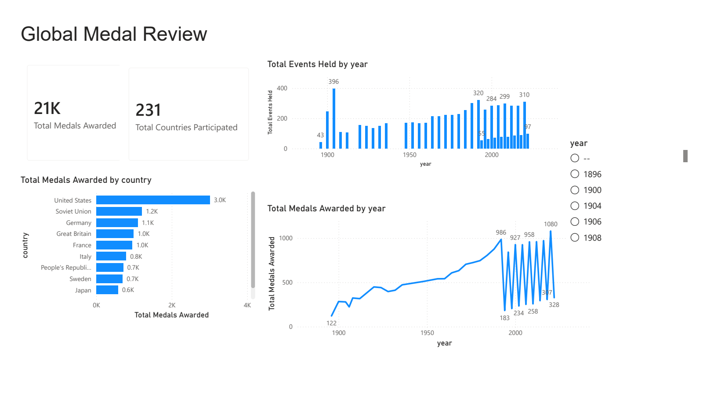
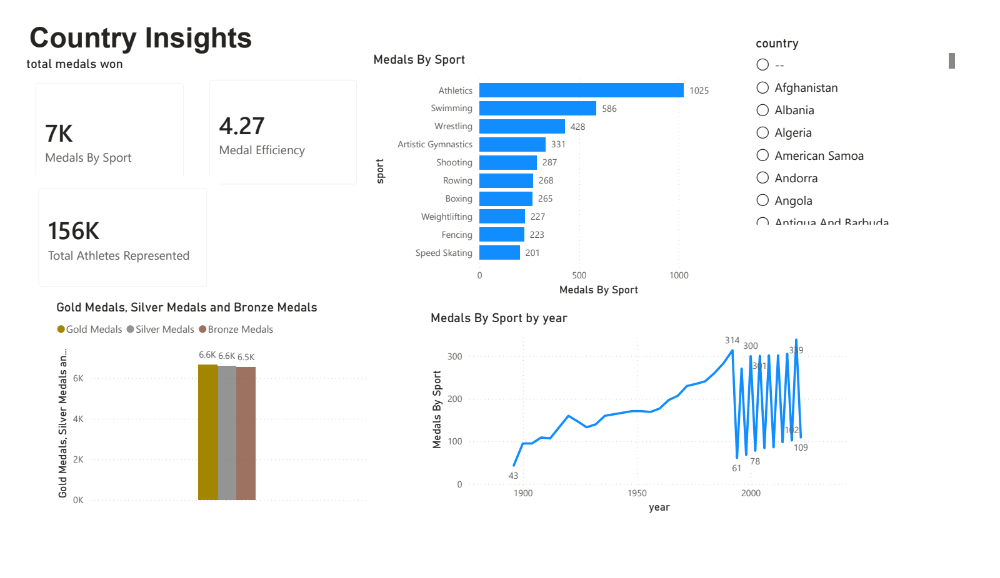
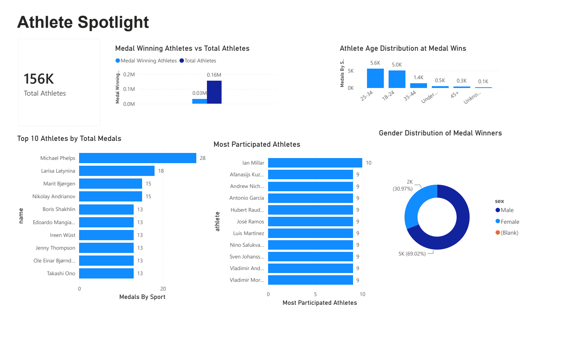
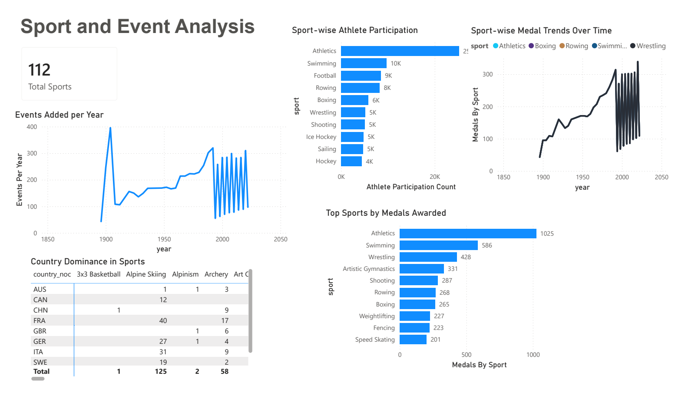
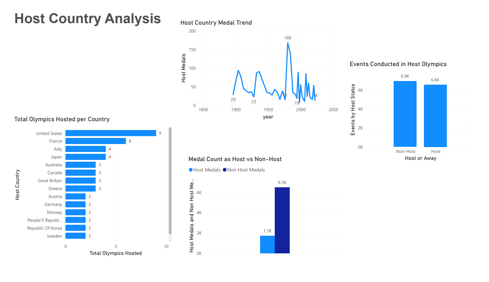
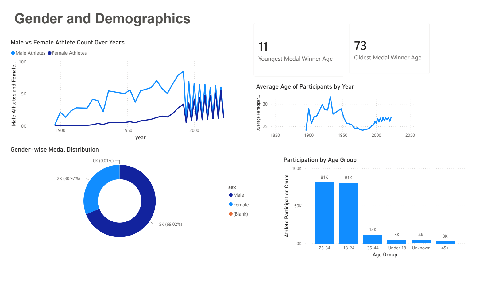

# Global Medal Review — Olympic Games Power BI Dashboard

A six-page interactive Power BI report on more than a century of Olympic history — **21K medals**, **156K athletes**, **231 countries** and **112 sports** — built to explore country performance, athlete careers, sport trends, host-country effects and participation demographics.

---

## Headline results

| Metric | Value |
|---|---:|
| Medals awarded | **21K** |
| Countries represented | **231** |
| Athletes | **156K** |
| Sports | **112** |
| Top country | **United States — 3.0K medals** |
| Top sport | **Athletics — 1,025 medals** |
| Most decorated athlete | **Michael Phelps — 28 medals** |
| Medal winners by gender | 69.0% male / 31.0% female |
| Youngest / oldest medal winner | 11 / 73 years |
| Most frequent host | **United States — 9 Games** |

## The six report pages

1. **Global overview** — medal totals by country and year, events held per year, KPI cards.
2. **Country insights** — medals by sport, gold/silver/bronze split, medal efficiency, country slicer.
3. **Athlete spotlight** — top 10 athletes by medals, most-participated athletes, age distribution and gender split.
4. **Sport and event analysis** — events added over time, top sports, country dominance matrix, participation by sport.
5. **Host country analysis** — Games hosted per country, host vs non-host medal counts, host medal trends.
6. **Gender and demographics** — male vs female participation over time, medal distribution, youngest/oldest winners and age groups.

### Dashboard preview

| Country insights | Athlete spotlight |
|---|---|
|  |  |

| Sport and event analysis | Host country analysis |
|---|---|
|  |  |

## What the dashboard shows

- **The US dominates the all-time medal table** with 3.0K medals, followed by the Soviet Union (1.2K), Germany (1.1K), Great Britain (1.0K) and France (1.0K).
- **Athletics is the biggest sport** (1,025 medals), ahead of Swimming (586) and Wrestling (428).
- **Medal counts rise with each Games** as more events and countries participate — the 1980s and 1990s expansions are clearly visible in the trend.
- **Host nations win more when hosting**, but the effect is concentrated in a few large delegations rather than universal.
- **Participation is still uneven by gender**: women account for 31% of medal winners across the full history, though the trend line shows steady convergence in recent decades.
- **Athlete longevity is rare**: only a small group appears in 9–10 Games, led by Ian Millar.

## Files

| File | Purpose |
|---|---|
| [`powerbi/Global_Medal_Review.pbix`](powerbi/Global_Medal_Review.pbix) | Editable Power BI report (open in Power BI Desktop) |
| [`docs/Global_Medal_Review_Dashboard.pdf`](docs/Global_Medal_Review_Dashboard.pdf) | Six-page PDF export for quick viewing |
| [`docs/figures/`](docs/figures/) | PNG previews of every report page |

## Data model

The report uses Olympic history tables covering athlete biographies, event results, countries, Games editions and medal tallies. Relationships connect results to athletes, countries and events; DAX measures handle medal counts, distinct athlete counts, medal efficiency and host/non-host comparisons.

**Source:** public “120 years of Olympic history” dataset (Kaggle). The PBIX embeds the data, so the report opens without any external files.

## Open it

1. Install **Power BI Desktop** (free, Windows).
2. Open `powerbi/Global_Medal_Review.pbix`.
3. Use the year and country slicers to filter the pages.
4. If you only want to review the output, open the PDF in `docs/`.

## Skills demonstrated

Power BI Desktop · data modelling · DAX measures · report design · slicers and cross-filtering · KPI cards · multi-page dashboard storytelling · PDF/PNG export

---

**Author:** Tanushka Kakkar · [LinkedIn](https://www.linkedin.com/in/tanushka-kakkar-8b33a0306/) · [Email](mailto:tanushkacareers@gmail.com)
